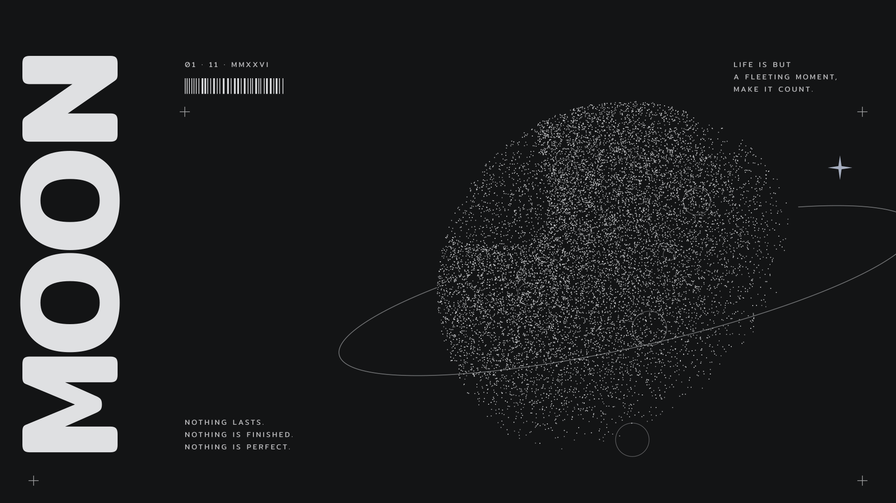

# SomeShell (rebuild)

A shell where everything happens through one **Island**, and the island changes with the workspace you are on.

> [!info] Status
> Design approved (island mockup, round 2, 2026-11-02). Next: plan the features (section 7), then code. No code yet. The old shell is archived as git tag `archive/shell-v1`; this machine still runs it until the new one is ready.

---

## 1. Why rebuild

The old shell grew feature by feature and the base got messy. Problems to never repeat:
- **Super+Tab sometimes can't switch workspace.**
- **Focus gets lost**: after changing workspace, the window there is sometimes not focused.
- **Blender misbehaves** with the shell running.
- Too many layers (glass, themes, pills, two layouts) built on top of each other, so every fix breaks something else.

The new shell starts from the rules in section 6 (System), so these bugs can't come back.

---

## 2. Look: "editorial monochrome"

Not just flat color. It should feel like a printed poster or a magazine page: ink on paper, made by hand.

The references were engraved, black-and-white posters (a moon with a vertical headline, "Memento mori" layouts, editorial collages) and a white desktop with black tabs hanging from the top edge. The default wallpaper is drawn in that style:

What the references have in common, and how it became the shell:

| In the posters | In the shell |
|---|---|
| Black and paper white, strong contrast | Colors come from the wallpaper (matugen): a dark ink and a light paper tone from its palette, and its accent for active things. The poster feel comes from type, lines and layout, not from removing color. |
| Huge headline type (MOON, DECAY) | The clock, the workspace name and the page titles are set big in Mitr SemiBold. |
| Small spaced-out caps (LIFE IS BUT A FLEETING MOMENT) | Labels, metadata and hints: small, uppercase, wide letter spacing, in Mitr. |
| Thin rules, crosshairs `+`, corner marks | Panels get hairline borders and corner marks instead of shadows or glass. Separators are drawn lines. |
| Index numbers, dates, barcodes, MMXXVI | Details that make it feel designed: `01 / 05` on pages, the date in small caps, a barcode-style progress bar. |
| Outlined pills and icon boxes | Buttons are outlined when off and filled ink when on. |

**Shape (from Desktop - 1):** the island is a black tab hanging from the top edge. It's flat against the screen edge with rounded bottom corners. The workspace is a small round badge top-left, and the system tray is another tab top-right. Little else is on screen.

**Motion: like print, not like jelly.**
- Opening: the island grows down from the edge, and its contents are revealed by a wipe, line by line.
- Lines draw themselves (a rule grows from left to right).
- Numbers roll like an odometer (clock, volume, battery).
- Text can type in for short labels (a notification title).
- Hover: an outline appears and the crosshair marks slide in. Press: invert (ink ↔ paper).
- Fast and exact (150–300 ms), with a small spring only where a shape changes size.

**Light and dark:** dark is a dark paper with light ink, light is a light paper with dark ink (like Desktop - 1). Both are first-class, both in the wallpaper's colors.

> [!check] Decided (2026-11-02)
> - Colors follow the wallpaper (matugen), every color, in light and dark.
> - One font for now: Mitr (Light, Regular, Medium, SemiBold).
> - No grain or texture.

---

## 3. The island

Everything is done through the island: control, search, media, all with just the **Super** key.

Design mockup, **approved** 2026-11-02 (round 2): https://claude.ai/artifact/6LrcbPr2QcDrkv24VohiGj

> [!check] Decided from the mockup
> - Pages are tabs along the **top** of the open island: icons, and the active one opens to show its number and name. The clock sits at the end of the tab row.
> - **Every page has its own island size**, shaped by its content, and the island reshapes with a spring when the page changes (Search tall and narrow, Notifications narrowest, System wide and short, Media music wide and short, Media video taller). Sub-pages (a tile's details, music vs video) resize too.
> - **Page switch (user, 2026-11-02): slide + wipe.** The old page fades out fast (~90 ms); the new page slides in 24 px from the side you moved toward (Tab or a tab to the right: from the right; Shift+Tab or a tab to the left: from the left) while it is wiped in top to bottom (~240 ms, ease-out). The tab underline slides to the new tab. The size spring settles without a visible bounce.
> - Island shape (tab with ears, plain tab, floating) and island color (always ink, or opposite of the desktop) both become options in Edit desktop. Default: tab with ears, always ink.
> - The mockup is a design reference, not code to copy. Its layouts break (overlap, content outside the island) because every page was drawn at a fixed size and the island was resized around it afterwards.

> [!warning] Lessons from the mockup (2026-11-02)
> - **The content sizes the island, never the other way round.** Each page lays itself out and reports its size; the island animates to that size. No fixed widths or heights for pages.
> - Nothing may draw outside the island or overlap; long text wraps or is cut with "…".
> - **Less motion.** One motion per action, and only where it tells you something changed.

### 3.1 How to call it
- **Super key:** press to open the island on the search page. Arrow keys to move, Enter to choose, Super or Esc again to close.
- **Mouse:** move onto the island and it **peeks** (grows a little and shows more). Click it to open fully, click outside to close. When it was opened by hover, moving away closes it.
- **Shortcuts to a page:** e.g. Super+V clipboard, Super+. emoji, Super+A control panel.

### 3.1b Answers (2026-11-02)
- **Two monitors:** the island follows the mouse to the monitor it is on. It can be turned off, or fixed to one monitor, in settings.
- **Several live things at once:** show them all. Music and recording together are both shown, each in a smaller version than when alone. A notification is short-lived: it shows over them for a few seconds and disappears, then the live things come back.
- **Motion:** fine as designed, except **nothing moves while you edit**. No wiggling tiles or icons in edit mode (control panel, desktop): you can't place things that move.

### 3.2 States
| State | When | Looks like |
|---|---|---|
| Rest | nothing happening | small tab: time, day, date |
| Live | music playing, recording, timer, call | tab grows to the side with a cover or dot, keeps the clock |
| Alert | a notification arrives | drops down for a few seconds, then back to rest |
| Peek | pointer on it | a bit bigger, shows a preview of the page |
| Open | Super or click | full panel with pages |
| Quiet | fullscreen game, do not disturb | shrinks to a thin line or hides |
| Level | a volume, mute, mic or brightness key | one row for a moment, then back |

> [!check] Decided (user, 2026-11-02: "island are not show volume up or down, let design it")
> - **Level** shows for 1.6 s after the last key press (holding a key keeps it), over rest, peek, quiet and alerts (the key press is the newest thing; an alert's own time keeps running). Not while the island is open (the open page already shows it).
> - One row, a little taller than rest: the icon (filled; `volume_off` when muted), a spaced-caps label (SOUND with the output's short name, MIC, BRIGHTNESS), the level as a row of thin bars like the media progress, and the percent rolling on the right. Muted: the bars and number turn to the muted color, the label says MUTED. The mic key shows MIC ON / MIC OFF, no bars.
> - The bars can be dragged or scrolled while it shows; that keeps it up.
> - Volume, mute and brightness keys go through the shell (global shortcuts), with the plain tools as the fallback while the shell is down. Volume steps by 5%; over 100% the bars stay full and the number keeps counting (max 150%).

### 3.3 Changes with the workspace (the main idea)
In the desktop editor (section 4) each workspace can get its own design: a name and what the island shows when resting. This is saved as part of the preset. Examples:
- `01 WORK`: rest shows the clock and next calendar event.
- `02 CODE`: shows the focused project or git branch, and DND on.
- `03 ART`: shows the pen and tablet state and a color picker shortcut, and the dock hidden.
- `04 PLAY`: the island goes quiet, game mode on.
- `05 MEDIA`: shows the playing media large.

Switching workspace animates the island to the new layout, and the workspace name flashes big for a moment like a poster headline.

### 3.4 Pages
Pages in the open island, tabs along the top, switched with Tab or arrows, numbered `01 / 07`:

**Search (first page)**
- Apps, quick math, files maybe later.
- `/` for commands: `/clip` clipboard history, `/gif`, `/emoji`, `/wall` quick wallpaper change, `/preset` switch preset, `/edit` edit desktop, `/settings`.
- Results as a clean list with big type for the top match.

**Control panel** (like Android and iOS)
- A snap grid with block sizes **1×1, 2×1, 1×2, 2×2**. Long-press or the pencil enters edit mode: blocks wiggle, drag to move, pull a corner to resize, remove or add from a drawer. The same editor arranges the island and the desktop (section 4).
- Each block is a toggle. Click it to go into its own page, like a phone.
  - **Internet:** Wi-Fi list, connect, forget, Ethernet, edit DNS, IP and proxy.
    > [!check] Decided (user, 2026-11-02): joining and editing Wi-Fi
    > - A new secured network asks inside the island: a password for home networks (WPA/WPA3 personal), a **username and password** for enterprise ones (802.1X: eduroam, a university network; PEAP with MSCHAPv2, the common setup).
    > - While joining the row says "Connecting…"; a failure stays on the form with the reason (wrong password, timeout). A failed new network leaves no broken saved profile behind.
    > - Right-click on a saved network shows **Edit** (enter the password or login again, the profile is kept) and **Forget**. Nothing is deleted by one click: Forget is its own button.
  - **Bluetooth:** pair, connect, rename, switch the audio device.
  - **Keep awake:** forever or for a time.
  - **Night light:** on/off, how warm, schedule (sunset to sunrise or set times).
  - **Do not disturb:** no notifications and no island alerts. Until a time, or while a game or screen share runs.
  - Also: sound output and mixer, mic, brightness, dark mode, game mode, screenshot, screen record, color picker, VPN/WARP, Quick Share, battery (laptop).

**Capture (screenshot and text)**
  > [!check] Decided (user, 2026-11-02: "build screen shot engine, can screen shot, text extract, other feature will later"; frozen screen, copy and save, Tesseract with English and Thai)
  > - One picker for every capture tool (screenshot now; text, then Lens, translate and region recording later). Super+Shift+S screenshots, Super+Shift+X copies text, the Control tile screenshots. Print and Ctrl+Print stay whole-monitor shots without the picker.
  > - **Frozen:** the key takes a picture of every monitor at once (`grim`), and a full-screen layer per monitor shows it, dimmed. Hover lights a window's box; a click takes that window, a drag draws a box (its size in spaced caps beside it), Enter takes the whole monitor, Esc or a right click cancels. A box stays on the monitor it started on.
  > - The picture is cut from the frozen copy at full pixel size (ImageMagick), so it is what you saw.
  > - **Screenshot:** copied to the clipboard and saved to `~/Pictures/Screenshots/Screenshot_<date>_<time>.png` (the XDG pictures folder). The island alerts with a small preview; a click on it opens the file.
  > - **Text:** Tesseract reads the box (English and Thai; small boxes are enlarged first), the text is copied and the island shows its start. Nothing read: the island says so and copies nothing.
  > - The picker is loaded only while picking; the frozen pictures live in `$XDG_RUNTIME_DIR` and are deleted after. While the shell is down the keys fall back to `slurp` (as now).

**Media**
- A browser extension (Zen/Firefox, later Chrome) sends the page info to the shell: site, title, full-size cover, and whether it's music.
  - music.youtube.com, Spotify web, SoundCloud → **music**
  - youtube.com, Netflix, other video → **video**
  - Without the extension: normal MPRIS, guessed by the player name.
- **Music design:** peek like a phone lock-screen player (cover, title, artist, progress). Full panel: big cover, synced lyrics, like button, queue, volume for that player.
- **Video design:** peek with a 16:9 thumbnail and progress. Full panel: thumbnail, chapters if any, skip ±10 s, picture-in-picture maybe.
- Poster touch: the track title set big, artist in spaced caps, the year and duration as small metadata.
  > [!check] Decided (user, 2026-11-02: "start build media and extension to fetch metadata"; Rust installed, unsigned install)
  > - Parts, all in `browser/`: the extension (`extension/`, Manifest V2 for Firefox/Zen: its background stays loaded, so the tab list and the helper connection survive; Firefox keeps V2), the native helper `someshell-browser` (`host/`, Rust, standard library only) and `install.sh` (builds the helper, writes the native-messaging manifest, packs the `.xpi`).
  > - Installed **unsigned and permanent**: Zen is built without forced signing, so `xpinstall.signatures.required = false` lets the `.xpi` stay installed. Signing through Mozilla can come later for other Firefox builds.
  > - The path: page script → extension background → native messaging (stdin/stdout) → helper → the shell's socket `$XDG_RUNTIME_DIR/someshell/browser.sock` (a Quickshell `SocketServer`), one JSON object per line. Back the other way for commands (like). The helper connects again when the shell restarts; nothing polls.
  > - Readers: every site through `navigator.mediaSession` (title, artist, album, the largest artwork); own readers where the site has more: YouTube Music (full-size cover, like state, music), YouTube (the full-size thumbnail, video). Each message says the site, the tab's address, music or video, and whether it plays.
  > - The shell matches the message to the browser's MPRIS player by title; when it matches, the extension's cover, site and kind win over the guess. Without the extension, nothing changes (MPRIS only).
  > [!check] Decided (user, 2026-11-02: "cover when island idle should be circle and that circle are duration"; "when peek island while media play, should show the time too")
  > - Resting island: the cover is a small circle, and a thin ring around it fills clockwise from the top as the track plays (the track's progress). The level meter beside it stays.
  > - Peek: under the playing row, the elapsed time, a thin progress line and the length (like a phone lock screen); a click on the line seeks. Left out when the length is unknown (live streams).
  > - The position is read once a second only while something plays and one of these is on screen (MPRIS does not push it), like the clock.
  > - Lyrics come from LRCLIB (not from the site), so songs without lyrics on YouTube still get them.
  > [!check] Decided (user, 2026-11-02: lyrics beside the player, the page grows)
  > - Music page: the cover and controls stay on the left; synced lyrics in a column on the right. The current line is big and bright and sits a third of the way down; the lines before and after are dimmed and scroll up as the song plays. No lyrics found: the page keeps its old width.
  > - Source: LRCLIB search by title and artist, the match whose length is within 3 s of the track, synced lyrics first, plain lyrics (shown as a still, scrollable column marked NOT SYNCED) after. Instrumental tracks say so. Only for music, only while the media page is open.
  > - Titles are cleaned before the search ("(Official Video)", "[MV]", "(Lyrics)"; " - Topic" from the artist).
  > - Cached in `~/.cache/someshell/lyrics/` per track: found lyrics forever, "not found" for a day; offline keeps nothing.
  > - Line changes are timed to the line's start (a one-shot timer to the next line), not to the once-a-second position read.
  > [!check] Decided (user, 2026-11-02: "let build the turn off for wrong match")
  > - A lyrics button (icon `lyrics`) joins the music controls whenever lyrics were found for the song. Lit while they show; a click hides them for this song (the page goes back to its narrow width), a click again brings them back.
  > - Remembered per song (cleaned title and artist, any length) in `~/.local/state/someshell/lyrics-off.json`.

**Notifications**
- Grouped by app, swipe or click to dismiss, reply when the app allows.
- History with "today", "yesterday".

**Calendar**
- Month grid like a printed calendar, today circled.
- Events from a local `.ics` or online calendar (decide later).
  > [!check] Decided (user, 2026-11-02)
  > - Events come from **calendar links**: the private iCal (ICS) address of a Google, Outlook or Apple calendar, listed in `shell.json` (`calendar.feeds`), plus any `.ics` files in `~/.config/someshell/calendar/`. Read only.
  > - A link is downloaded when the page opens and its copy is older than 15 minutes; the copy (`~/.cache/someshell/calendar/`) keeps the page working offline. Nothing runs while the page is closed.
  > - Repeating events: daily, weekly (with weekdays), monthly, yearly, with interval, count, until and skipped dates. Times in a calendar's own zone are shown as local time.
  > - The week starts on **Sunday** (`calendar.weekStart`, "sunday" or "monday").
  > - Layout: the month as a printed grid (month name big, weekday initials, today circled, a dot under days with events), and the chosen day's events beside it (time, title, place). Today is chosen when the page opens; a click picks another day; the mouse wheel, or the ‹ › buttons, change the month.

**Resources**
- CPU, GPU, RAM, temperature, disk, network.
- Drawn as editorial charts: thin lines, big numbers, no gauges.
  > [!check] Decided (user, 2026-11-02: "start step 5 with the system page")
  > - One row of columns, wide and short: **CPU, Memory, GPU, Network, Disk, Battery**. Each column: a spaced-caps label, a big rolling number, a thin line of the last 60 seconds (Disk: a thin bar), and one small line of detail.
  > - CPU: load, temperature, core count. Memory: used, of total. GPU: load where the driver gives it (NVIDIA, AMD); on others (Adreno) the clock against its maximum, labelled as clock; temperature. Network: download speed (line), upload in the detail. Disk: the root disk used, free. Battery (only with one): percent, charging or not, power draw and health when UPower knows them.
  > - A column whose source is missing is left out (no GPU column without a readable GPU, no battery on a desktop).
  > - Sampled once a second by one small script that runs only while the page is open (no process per sample).
  > - The tray's battery opens this page.

**Operation (power)**
- Lock, sleep, log out, restart, shut down.
- Hold to confirm, the button fills like ink.
  > [!check] Decided (user, 2026-11-02: an accidental press of the tablet's power key shut it down; "it should just lock screen and black out light")
  > - The power key locks and turns the screens off, like a phone; pressed again it turns them back on (the lock screen shows). Shutting down stays on the power page.
  > - Hyprland holds logind's power-key block (`systemd-inhibit --what=handle-power-key`) for the session; without a session, logind's own setting applies. No system file changes.
  > - Volume keys: raising the volume also unmutes it.

---

## 4. Edit desktop

One edit mode for the whole desktop, like a phone home screen. Open it with `/edit`, a right-click on the desktop, or a long press.
- The desktop zooms out a little and a grid appears.
- **Widgets:** a drawer at the bottom, drag a widget onto the desktop, it snaps to the grid, pull to resize.
- **Island:** choose a style, position (top center, top left…) and what it shows when resting.
- **Dock:** on/off, position, auto-hide, pinned apps.
- **Wallpaper:** swipe through wallpapers right there, the colors update live.
- **Workspaces:** name each workspace and design what its island shows (section 3.3).

**Presets.** After setting up the desktop (wallpaper, workspace designs, widgets, island, dock), save it as a preset, for example "Clean", "Work" or "Stream". Apply any preset any time with `/preset` or from the editor, and the whole desktop changes to it. Editing a preset and saving updates it; "save as new" makes another.

Widget ideas: clock (poster style, huge), now playing, calendar, notes, system, weather, photo frame, quote or text (for poster-like typography on the desktop).

---

## 5. Other parts (smaller)
- **Workspace badge** (top-left): the workspace number in a circle. Click for overview, scroll to switch.
- **Tray tab** (top-right): system tray and status icons.
  > [!check] Decided (user, 2026-11-02): the tray carries the status
  > - Left to right: app tray icons (Discord and the like, Quickshell `SystemTray`), keyboard layout, network, Bluetooth, battery. Each status icon shows only where the hardware is there (no battery on the desktop, no Bluetooth without an adapter).
  > - Network: Ethernet, Wi-Fi with signal bars, searching, off. Bluetooth: on, connected (with a device), hidden when off. Battery: icon and percentage (rolling digits), a bolt while charging, the error color at 20% and below while discharging.
  > - Click: network → Internet page, Bluetooth → Bluetooth page, layout → next layout, battery → System page.
  > - Battery alerts on the island at 20% and 10% while discharging, once each until it charges again; 10% shows even with Do not disturb.
- **Overview** (Super+Tab): workspaces as a row of "pages" with their names big. It must always switch (see section 6).
- **Lock screen:** big clock in poster style, password dots that pop in and shake when wrong.
- **Dock:** optional, hidden by default?
- **On-screen keyboard, capture tools, game overlay:** later, after the core works.

---

## 6. System (how it's built)

Rules that fix the old bugs by design:

1. **Hyprland owns windows and focus, the shell never does.** Switching workspace, focusing and moving windows are always Hyprland dispatches. The shell only asks; it never keeps its own idea of which window is focused.
2. **The shell takes keyboard focus only while you type in it.** When the island closes, focus goes straight back to the window under it. No layer keeps `Exclusive` focus. This is the likely cause of "window not focused after switching workspace" and of Blender problems.
3. **Keys stay with apps.** The shell grabs as few global keys as possible. Super alone opens the island only when it's pressed and released with nothing else, so Blender, games and other apps keep every Super+key combo.
4. **Overview is simple and reliable.** Super+Tab always switches. Clicking or pressing Enter on a workspace switches and closes, every time.
5. **Small core, clear parts.** One service per system thing (audio, network, bluetooth, media, notifications, power). Pages only load while open. No polling: everything reacts to events.
6. **Light.** No glass by default, no blur on big areas. A memory and idle-CPU budget checked on every big change.
7. **Settings live in the shell.** Edit mode and the control panel replace most of the separate settings app; a settings page remains only for rare options.
8. **Testable.** Every feature can be triggered from the command line (IPC), so each bug can be reproduced and tested after a fix.

Before building, reproduce each old bug on v1 and write down the cause, so the design really avoids it:
- [ ] Super+Tab not switching workspace: when, and what was focused
- [ ] Window not focused after a workspace change: with keys, mouse or overview?
- [ ] Blender: what goes wrong (shortcuts, menus, focus, tablet)?

> [!check] Scope (decided 2026-11-02)
> Everything is rebuilt fresh: the shell, the Hyprland config (keybinds, rules, look), colors, installer. Nothing is brought back from the old version; it's only read to learn what went wrong.

---

## 7. Features: how each one works

The design is the easy part; features are where the work is. For each feature: where the data comes from, how the shell gets it, and what makes it hard. Difficulty: ● easy, ●● some work, ●●● hard.

Built on Quickshell. It already ships modules for Hyprland, PipeWire audio, media players (MPRIS), notifications, Bluetooth, battery (UPower), the system tray, app list, lock screen and PAM. Everything else talks to a command-line tool or a file.

### 7.1 Foundation
| Feature | Source and method | Hard part | |
|---|---|---|---|
| Workspaces, windows, focus | Quickshell Hyprland module (live events); actions are Hyprland dispatches | Never keep our own copy of focus (rule 1); reread state after a config reload | ●● |
| Super tap opens the island | Hyprland bind on Super release, only if no other key was pressed | Must not fire after Super+key combos (Blender); test that first | ●● |
| Keyboard focus | Island layer takes no keyboard at rest, takes it only while open; an outside click closes it | The old focus bugs came from here: test with Blender, games, fullscreen | ●●● |
| Colors from wallpaper | matugen writes a color file on wallpaper change; the shell watches it; templates for Hyprland, GTK, KDE, terminals, Zen | Light/dark switch and gray wallpapers (scheme-smart) | ● |
| Wallpaper | Shell draws it (screen-sized copy for memory); video later with mpvpaper | Big images use a lot of memory | ●● |
| Motion parts | Shared pieces: wipe-in, drawn line, rolling digits, typing text, crop marks, press invert, per-page resize | Qt crashes with a spring inside a sequence (known); keep idle CPU at 0 | ●● |
| Island states | One window, one state machine: rest, live, alert, peek, open, quiet | Several live things at once (music + recording + alert): need a priority order | ●● |

### 7.2 Island pages
| Feature | Source and method | Hard part | |
|---|---|---|---|
| Search apps | Quickshell app list (desktop files), fuzzy match, recent apps first | Good ranking | ● |
| Quick math | Own small parser (never `eval`) | Units and currency later | ● |
| `/clip` clipboard | cliphist (stores in the background); read when opened | Image previews: decode once and cache | ●● |
| `/emoji` | Bundled emoji list with names and skin tones | — | ● |
| `/gif` | Klipy API with the user's key; files downloaded, played locally | Network errors, saved GIF folders | ●● |
| `/wall` | Wallpaper folder, cached thumbnails | — | ● |
| Internet | NetworkManager through `nmcli` (live events from `nmcli monitor`) | Asking for a Wi-Fi password inside the island; DNS and IP editing; hidden networks | ●●● |
| Bluetooth | Quickshell Bluetooth module (BlueZ) | Pairing with a PIN; renaming the PC | ●● |
| Sound and mixer | Quickshell PipeWire module: outputs, inputs, per-app volume | Switching output while playing | ●● |
| Brightness | `brightnessctl` on laptops, `ddcutil` for desktop monitors | DDC is slow: queue changes and send only the last | ●● |
| Night light | `hyprsunset` (Hyprland's own) with a temperature; schedule computed in the shell | Sunset times need a location setting | ●● |
| Keep awake | Idle inhibitor (Quickshell) | — | ● |
| Do not disturb | Our own notification server holds alerts | Auto-on during games and screen share | ● |
| Game mode | Hyprland settings off (blur, animations) while a fullscreen game is focused | Telling a game from a fullscreen video | ●● |
| Screenshot, record, color picker | `grim` + own region picker, `gpu-screen-recorder` or `wf-recorder`, `hyprpicker` | Region picker in the new look; NVIDIA encoding | ●● |
| WARP, Quick Share | `warp-cli`; Quick Share helper (Rust) | Only when installed; later | ●● |
| Battery (laptop) | Quickshell UPower module | Hidden on a desktop | ● |
| Control layout editing | Snap grid 1×1, 2×1, 1×2, 2×2, saved in the config | Drag and resize feel; the same editor is reused for the desktop (7.3) | ●●● |
| Media | Quickshell MPRIS module: any player | Several players at once: pick the active one | ●● |
| Browser extension | Firefox/Zen extension + a small native helper (Rust) that sends JSON to the shell over a local socket: site, title, full-size cover, like state | Store review and signing for Firefox; each music site needs its own reader; works without it (MPRIS only) | ●●● |
| Music vs video | Site from the extension, or the player's URL in MPRIS | Unknown sites default to video | ● |
| Lyrics | LRCLIB (free, synced lyrics) by title, artist and length; cached | Wrong matches; turn off per track | ●● |
| Notifications | Quickshell notification server; history saved to a file | Actions and inline reply differ per app; images in notifications | ●● |
| Calendar | Month grid (no data needed); events from a local `.ics` first | Online calendars (Google) need sign-in: later | ●● |
| System | `/proc` and `/sys` read once a second **only while the page is open**; GPU from `nvidia-smi` or AMD files | Sampling is polling, so it stops the moment the page closes | ●● |
| Power | `systemctl` suspend, reboot, poweroff; Hyprland exit; own lock | Hold-to-confirm | ● |

### 7.3 Desktop
| Feature | Source and method | Hard part | |
|---|---|---|---|
| Workspace designs | Hyprland workspace events pick the island design; designs stored per workspace in the preset | Switching quickly between workspaces must not stack animations | ●● |
| Edit desktop | Zoomed-out desktop with a grid, widget drawer, island/dock/wallpaper options | The biggest single feature: drag, snap, resize, undo | ●●● |
| Widgets | One file per widget, on the bottom layer, hidden in games | Each widget is its own small feature | ●● each |
| Presets | A preset is one folder: settings file + wallpaper path; apply swaps everything at once | Applying must be atomic (no half-applied desktop) | ●● |
| Lock screen | Quickshell lock + PAM; `hypridle` locks on idle and before sleep | If the shell crashes while locked, Hyprland's fallback must take over | ●●● |
| Overview (Super+Tab) | Workspaces as pages with app icons first, live previews later | Previews cost memory and GPU; must always switch (rule 4) | ●● |
| Workspace badge, tray tab | Hyprland module, Quickshell tray module | Tray menus | ● |
| Dock | Optional | Pinned apps, drag to reorder | ●● |
| Installer | Packages, fonts, links with backups, rollback | Fresh machine test | ●● |

## 7b. Decisions before code (2026-11-02)

The user answered these; the rest are my proposed defaults, accepted by not changing them. Any can still change.

**From the user**
- Settings: a **separate window** for the rare options (not an island page).
- Dock: **keep it**.
- Keybinds: **keep the same keybinds as v1** (`git show archive/shell-v1:hypr/binds/keybinds.lua`), rewritten fresh in the new config.
- Testing: build the base, then use it and **replace the current shell**.

**Defaults**
- Island: follows the mouse only while closed; workspace badge on every monitor; tray with the island. Fullscreen video hides it like a game (back at the top edge). Opened by hover closes when the mouse leaves; opened by Super stays. Size cap 60% width, 70% height, longer pages scroll inside.
- Several live things: clock in the middle, one on each side; three or more show the two most important plus "+1". Peek or open shows one row per live thing with its own controls.
- Edit mode: tiles get a dashed outline, a remove button and a resize corner, all still; the dragged tile lifts and follows the mouse; others slide aside on drop.
- Look: Material Symbols Rounded, thin outline off, filled on. English UI. Windows: rounded like the island, thin wallpaper-colored border on the focused one, small gaps.
- Hyprland: dwindle tiling; workspaces 1–10 per monitor; Kitty, Zen, Dolphin; touchpad swipe on the laptop; pen mapped to a monitor chosen in settings.
- Search: apps, math, commands; anything else searches the web (Google). Clipboard on Super+V: text and images, 200 items, kept after reboot. Notifications only on the island, queued.
- Lock: hypridle locks after 10 minutes and before sleep; hyprlock is the backup if the shell crashes.
- Night light 20:00–07:00 fixed; calendar from a local `.ics`; extension for Zen/Firefox first; recording with gpu-screen-recorder.
- Memory target: under 300 MB while idle.

## 8. Build order

Each step ends with something that runs and is checked on the desktop. Commits stay local until **base** is done, then everything is pushed.

1. **Hyprland config, fresh.** Keybinds, window rules, look, focus behavior, Super tap. Check the three old bugs are gone (section 6).
2. **Shell skeleton.** Colors from the wallpaper, Mitr, motion parts, the island window with all states, workspace badge, tray tab.
3. **Search and power.** Apps, math, commands, `/clip`, `/emoji`, `/wall`; the power page.
4. **Control, media, notifications.** Tiles in a fixed layout with their detail pages; media through MPRIS; notifications with history.

**→ Base done: push to GitHub.**

5. Browser extension, music layout, lyrics. Calendar and system pages.
6. Edit desktop: grid editor, widgets, presets, workspace designs, control layout editing.
7. Lock screen, overview, dock, installer.
8. Later: GIFs, Quick Share, WARP, capture tools, game overlay, on-screen keyboard.

